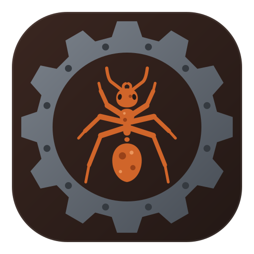

<div align="center">
  <a href="https://jonasheinle.de">
    
  </a>

  <h1>OxidANT</h1>

  <h4>The Kataglyphis family's Rust crates and the Rust best practices they follow.</h4>
</div>

<div align="center">
  <a href="https://jonasheinle.de">
    
  </a>
</div>

[](https://github.com/Kataglyphis/OxidANT/actions/workflows/linux-x64.yml)
[](https://github.com/Kataglyphis/OxidANT/actions/workflows/linux-arm64.yml)
[](https://github.com/Kataglyphis/OxidANT/actions/workflows/linux-riscv64.yml)
[](https://github.com/Kataglyphis/OxidANT/actions/workflows/windows-x64.yml)
[](https://github.com/Kataglyphis/OxidANT/actions/workflows/windows-arm64-cross.yml)
[](https://github.com/Kataglyphis/OxidANT/actions/workflows/github-code-scanning/codeql)
[]()
[](https://www.paypal.com/paypalme/JonasHeinle)
[](https://twitter.com/Cataglyphis_)

A push to `develop` and every PR run Linux x64; the other lanes run on request and before
a release, so a lane's badge shows its runs started by hand and a requested run is listed
under *On request*
([AGENTS.md § Continuous integration](https://github.com/Kataglyphis/OxidANT/blob/develop/AGENTS.md#continuous-integration)).
PowerShell lint stays strict, and the separate quality workflow uploads a complexity report
on each push and PR; its manual `strict` input tests the current complexity debt.

[**Docs site**](https://rust.jonasheinle.de)

OxidANT is the Kataglyphis family's **Rust workspace**: the crates two other
repositories build as a submodule, plus the Rust practices, gates and packaging they
all inherit. [OmniAccelerANT](https://github.com/Kataglyphis/OmniAccelerANT) calls the
root package through flutter_rust_bridge and ships ObservANT, the cat cam;
[BeschleunigerBallett](https://github.com/Kataglyphis/BeschleunigerBallett) links the
cxx bridge crate through Corrosion and builds the WebGPU renderer. It started as a project template and
that scaffolding is still here, but the crates are real code with real consumers.

Dependency updates: run `bash scripts/linux/renovate-local.sh` to report, `--apply --dry-run` to plan,
and `--apply` to update. CI checks the wrapper and config; see
[the shared Renovate guide](https://github.com/Kataglyphis/ANTfrastructure/blob/develop/docs/dependency-updates.md).

## Highlights

- **ObservANT** (`crates/observant`): camera, cat detection, WebRTC stream and web page in one service.
- **A WebGPU glTF renderer**, native and in the browser: PBR with IBL, shadows, SSAO, bloom, golden tests.
- **ONNX inference** on the family's chain-built ONNX Runtime (CPU, DirectML, CUDA), with tract as its fallback.
- **No feature flags**: every build carries everything its target can run.
- **GStreamer capture**, a wgpu GUI overlay with FPS, latency and CPU, and a GTK4 camera GUI on Linux.
- **Five build lanes**: Linux x64, arm64 and riscv64, Windows x64 and arm64.
- **Packages** that carry their own GStreamer, ONNX Runtime and model: tar, deb, AppImage and flatpak on Linux; portable zip, MSI and MSIX on Windows.

## Quick start

```bash
git clone --recurse-submodules --branch develop https://github.com/Kataglyphis/OxidANT.git
cd OxidANT
cargo build --workspace --locked
```

Prerequisites, the API docs and Linux containers locally:
[docs/getting-started.md](https://github.com/Kataglyphis/OxidANT/blob/develop/docs/getting-started.md).

## Documentation

| Topic | Read |
| --- | --- |
| Getting started | [docs/getting-started.md](https://github.com/Kataglyphis/OxidANT/blob/develop/docs/getting-started.md) |
| The crates, what each target builds, and the consumers | [docs/crates.md](https://github.com/Kataglyphis/OxidANT/blob/develop/docs/crates.md) |
| Tests, lints and the GPU tests | [docs/testing.md](https://github.com/Kataglyphis/OxidANT/blob/develop/docs/testing.md) |
| Running the CLI, the GUI and the demos | [docs/running.md](https://github.com/Kataglyphis/OxidANT/blob/develop/docs/running.md) |
| ObservANT, the cat cam | [docs/observant.md](https://github.com/Kataglyphis/OxidANT/blob/develop/docs/observant.md) |
| Windows: build, test and arm64 test-artifact checks | [docs/windows.md](https://github.com/Kataglyphis/OxidANT/blob/develop/docs/windows.md) |
| Packages: Linux tar, deb, AppImage, flatpak; Windows MSIX and MSI | [docs/packaging.md](https://github.com/Kataglyphis/OxidANT/blob/develop/docs/packaging.md) |
| Dependency updates | [docs/updates.md](https://github.com/Kataglyphis/OxidANT/blob/develop/docs/updates.md) |
| The WebGPU renderer | [crates/webgpu_renderer/README.md](https://github.com/Kataglyphis/OxidANT/blob/develop/crates/webgpu_renderer/README.md) |
| Shader ownership and regeneration | [docs/shaders.md](https://github.com/Kataglyphis/OxidANT/blob/c930e59ae429748cdc81a51b6e96aaca55c79179/docs/shaders.md) |
| API docs (rustdoc) | [rust.jonasheinle.de](https://rust.jonasheinle.de) |
| Rules for agents and contributors, CI | [AGENTS.md](https://github.com/Kataglyphis/OxidANT/blob/develop/AGENTS.md) |
| Known work | [BACKLOG.md](https://github.com/Kataglyphis/OxidANT/blob/develop/BACKLOG.md) |
| Changes | [CHANGELOG.md](https://github.com/Kataglyphis/OxidANT/blob/develop/CHANGELOG.md) |

## Contributing and contact

OxidANT is one of the [Kataglyphis repositories](https://github.com/Kataglyphis/ANTfrastructure/blob/develop/docs/repository-family.md),
which share one way to contribute and one contact. Licence: MIT, see [LICENSE](https://github.com/Kataglyphis/OxidANT/blob/develop/LICENSE).
